# GitHub Universe 2026 badge: my apps

Six extra apps for the GitHub Universe 2026 badge, on top of the stock firmware tree from [badger/home](https://github.com/badger/home). Games, a GitHub dashboard, and a few radio and aviation toys: APRS stations on a map, planes overhead, and a MeshCore message viewer.

None of this has run on a real badge yet. Everything below passes static checks and host-side tests only. Each app's status is in the table, and I'll update it as I test.

## Apps

| App | What it does | Needs network | Status |
| --- | --- | --- | --- |
| [`tilt_maze`](badge/apps/tilt_maze/) | Roll a marble through a random maze with the accelerometer. 4 sizes, best times saved. | no | maze generator tested on host, tilt axes unconfirmed |
| [`ir_tag`](badge/apps/ir_tag/) | Fire IR shots at other badges. A hit badge sends a confirmation back. | no | sender call fixed to the real `aye_arr` API, untested |
| [`gh_dash`](badge/apps/gh_dash/) | Review requests, open PRs, assigned issues, latest CI result for up to 3 repos. | Wi-Fi + GitHub token | demo mode works, live calls untested |
| [`aprs_map`](badge/apps/aprs_map/) | Live map of APRS stations near a place you choose, with fading trails. Receive only. | Wi-Fi | parser tested on host and against the live feed |
| [`overhead`](badge/apps/overhead/) | Aircraft near you: callsign, type, altitude, speed, origin and destination, arriving or departing. List and radar views. | Wi-Fi | parser tested on saved real responses |
| [`meshcore_feed`](badge/apps/meshcore_feed/) | MeshCore messages and contacts from your own BLE companion node. | BLE | prototype, about 3% odds live mode can pair, demo mode works |

`validate_app.py` and the README check pass for all six. The `editor/` folder holds single-file copies you can paste into the [browser editor](https://badger.github.io/editor) plus host-side tests. In the simulator the accelerometer is a stub (use the d-pad for `tilt_maze`), and there is no IR, network or BLE, so the other apps run on demo data.

## Screenshots

Captured from the [badge simulator](https://badger.github.io/editor) running each app in headless Chrome, not from a real badge. Frames are the simulator's screen, doubled in size. The simulator has no real accelerometer, IR, sockets or network, so `tilt_maze` was rolled with the d-pad, `ir_tag` shows its simulator controls, and `aprs_map`, `gh_dash` and `overhead` show demo data (the `overhead` captures use `PLANES_DEMO`). `meshcore_feed` is its demo mode, and the captured start screen shows the warning that live mode probably fails.

**tilt_maze**: start, then rolling toward the gold tile

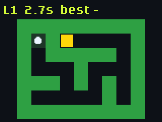 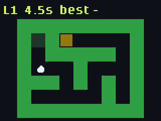

**ir_tag**: after a confirmed hit, then after being tagged

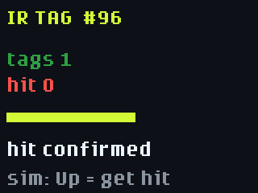 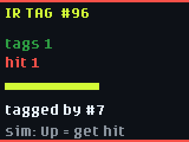

**gh_dash**: review requests, PRs, issues and CI

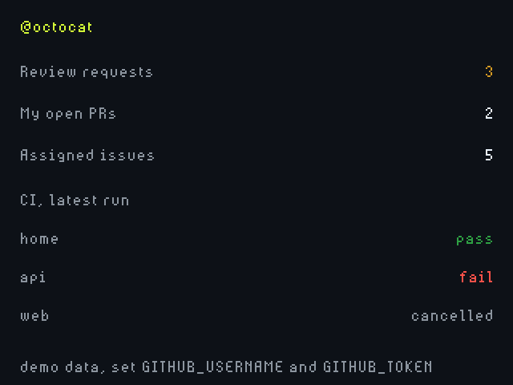

**aprs_map**: stations with trails, then zoomed on a selected station

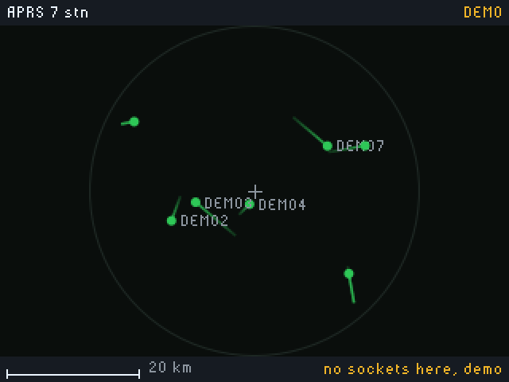 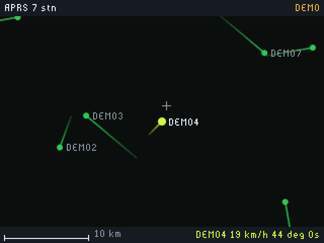

**overhead**: list with detail, then the radar

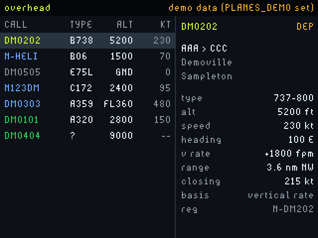 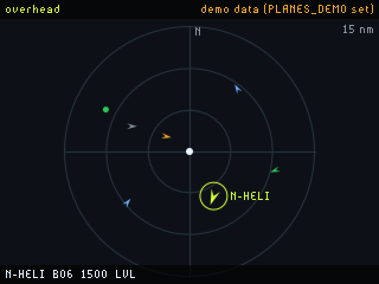

**meshcore_feed**: start screen, then demo messages

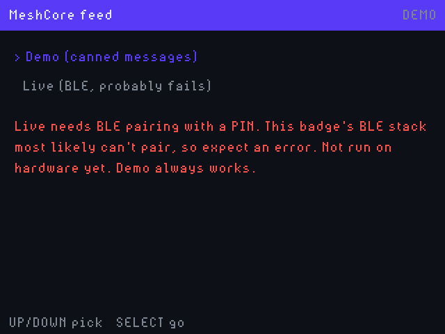 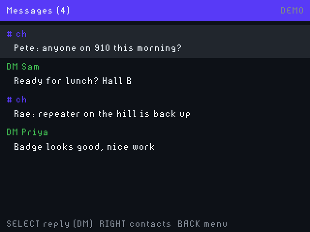

## Quick setup

1. Install the tool: `python3 -m pip install mpremote` (use a venv if pip refuses).
2. Plug in the badge with a data-capable USB-C cable and find it: `mpremote devs` (USB id `2e8a:1101`).
3. Put it in disk mode: `mpremote connect "$PORT" exec "import powman; powman.reset_into_msc()"`. A `Device not configured` error afterwards is expected. The Mass Storage app or a double-tap on reset also work.
4. While still in serial mode, check the menu draws custom icons:
   `mpremote connect "$PORT" exec "print('load_picture' in open('/system/apps/menu/app.py').read())"`.
   If it prints `False`, also copy `badge/apps/menu/app.py` to the volume in the next step, otherwise the new apps get the default icon.
5. Copy the apps to the `BADGER` volume. Its root is the badge's `/system`, so apps go in `apps/`. Never copy to the `RP2350` drive, that is the bootloader.

```bash
cp -R badge/apps/{tilt_maze,ir_tag,gh_dash,aprs_map,overhead,meshcore_feed} /Volumes/BADGER/apps/
diskutil eject /Volumes/BADGER
mpremote connect "$PORT" reset
```

The repo's `.github/skills/hyb26-skill/scripts/` has helpers for the same steps (`badge_serial.py`, `deploy_app.py`, `patch_menu_icons.py`, `validate_app.py`). The deploy and patch scripts preview by default and need `--write`.

## Settings the apps read

Wi-Fi and your GitHub username can be set in the badge's Settings app. Everything else goes in `secrets.py`. I haven't confirmed whether the Settings app writes `/secrets.py` or `/system/secrets.py`, so check both with `mpremote connect "$PORT" fs cat :/secrets.py` and add lines to the one that holds your Wi-Fi values.

| Name | Used by | Notes |
| --- | --- | --- |
| `WIFI_SSID`, `WIFI_PASSWORD` | `gh_dash`, `aprs_map`, `overhead` | |
| `GITHUB_USERNAME` | `gh_dash` | |
| `GITHUB_TOKEN` | `gh_dash` | fine-grained, read-only, short expiry |
| `DASH_REPOS` | `gh_dash` | optional, `"owner/repo,owner/other"`, up to 3 |
| `MAP_LAT`, `MAP_LON` | `aprs_map`, `overhead` | optional, decimal degrees. Defaults to the GitHub Universe 2026 venue (37.8068, -122.4315). |
| `MAP_RADIUS_KM` | `aprs_map` | optional, default 25 |
| `PLANES_RADIUS_NM` | `overhead` | optional, default 15, range 3 to 40 |
| `APRS_CALLSIGN` | `aprs_map` | optional, goes in the APRS-IS login line, defaults to `N0CALL` |
| `APRS_DEMO`, `PLANES_DEMO` | `aprs_map`, `overhead` | optional, set to `1` to force demo data |

`secrets.py` is plain text on a device other people pick up. Use a token that can only read what the dashboard needs, and never commit real values. `badge/secrets.py` in this repo stays empty.

## Things I'm checking on hardware

- **IR library version.** `ir_tag` uses the real [`pimoroni/aye_arr`](https://github.com/pimoroni/aye_arr) API (`NECSender(pin, pio, sm)` then `.start()`, receiver via `NECRemoteReceiver` or `NECReceiver`), checked against its source but not on a badge. In `aye_arr` 1.0.x the descriptor style Quest uses moved to `NECRemoteReceiver`, so check which version the firmware ships with `import aye_arr.nec as n; print(dir(n))`. Without a working sender the app runs receive only and says so.
- **Tilt direction.** Axis mapping is copied from the stock Badge app. If the ball rolls backwards, flip a sign in `Tilt.read()`.
- **BLE pairing.** MeshCore needs a bonded, encrypted link with a PIN. MicroPython only supports that on NimBLE, and the badge probably uses BTstack, so live mode most likely cannot pair (review estimate: about 3%). Demo mode works. A Wi-Fi companion node over TCP would avoid pairing. See [`editor/meshcore-feasibility.md`](editor/meshcore-feasibility.md) for sources.
- **Sockets and RAM.** `aprs_map` connects over a raw TCP socket (the first connect can block a few seconds). `overhead` parses 40 KB or more of JSON. Lower `PLANES_RADIUS_NM` if it runs out of memory.
- **Screen layout.** Text widths and column positions are guessed and checked only against stub globals.

## Data sources and limits

- **APRS:** the [APRS-IS](https://www.aprs-is.net/) network via `rotate.aprs2.net:14580`, with a server-side range filter and a receive-only login (passcode `-1`). The app never transmits. I skipped the aprs.fi API because it can't search by area and its terms forbid pre-caching.
- **Aircraft positions:** [adsb.lol](https://api.adsb.lol), open data under the [ODbL 1.0](https://opendatacommons.org/licenses/odbl/1-0/). No key today, but they say one may be required later. It returned a rate-limit header that might mean 500 requests per day per address, so `overhead` refreshes every 2 minutes (about 240 requests in 8 hours). The header is unofficial. Venue Wi-Fi shares one IP, so the cap could still be hit. If `overhead` starts showing HTTP errors, raise `REFRESH_MS`.
- **Aircraft routes:** [adsbdb](https://www.adsbdb.com), looked up by callsign and cached. Callsigns get reused, so arriving and departing is a good guess, not a fact. How the app decides is in [`badge/apps/overhead/README.md`](badge/apps/overhead/README.md).
- **MeshCore:** the documented companion protocol from [meshcore-dev](https://github.com/meshcore-dev). Live mode can send a real message on your mesh when you pick a canned reply.

## Upstream and license

This is a fork of [badger/home](https://github.com/badger/home), the GitHub Universe 2026 badge firmware tree, which is based on Pimoroni's [Tufty 2350](https://shop.pimoroni.com/products/tufty-2350). The original README is in `UPSTREAM_README.md`. For the 2026 API, read [`badge/AGENTS.md`](badge/AGENTS.md) and [`hardware/README.md`](hardware/README.md) first, and don't use `badge25/` patterns.

MIT, same as upstream. See [`LICENSE`](LICENSE). I wrote the six apps above. The upstream project asks that contributions contain no third-party characters, art, logos or trademarks, and the apps follow that.
